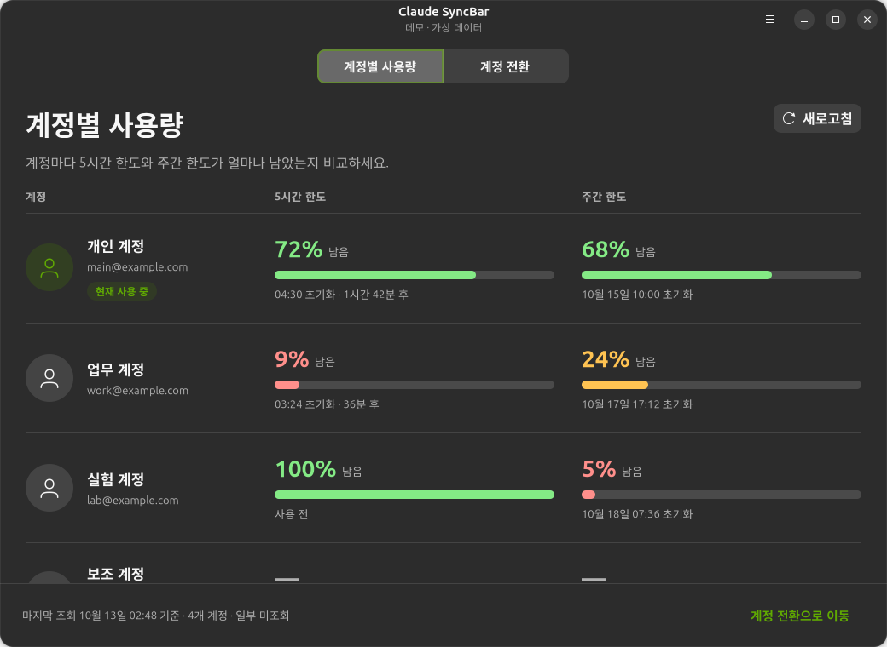
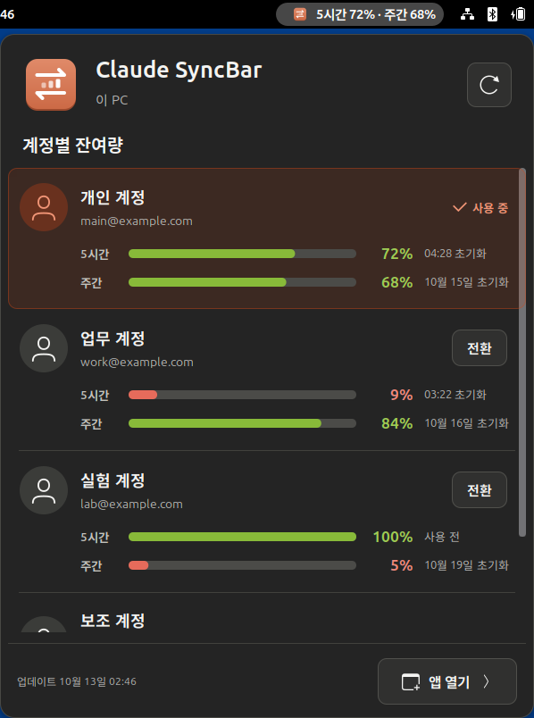

# Ubuntu 앱

Claude SyncBar Ubuntu는 **GTK 4·libadwaita 화면과 .NET 10 사용자 서비스**로 구성된 네이티브 계정 관리자입니다. 현재 적용 계정과 적용할 계정을 나란히 보여 주고, 사용량과 로컬·SSH 장치별 `현재 → 적용 예정` 상태를 확인한 뒤 전환합니다. 계정을 선택하는 것만으로 로그인을 바꾸지 않습니다.

첫 화면의 **계정별 사용량** 페이지는 계정마다 **5시간 한도와 주간 한도의 잔여량**을 두 열로 보여 줍니다. 각 칸에는 남은 비율, 막대, 초기화 시각(5시간은 남은 시간도)을 표시하고, 계정 쪽에는 현재 사용 중인지와 조회 상태를 한 번만 표시합니다. 미조회는 `—`, 소진은 `0%`, 아직 쓰지 않은 5시간 창은 `사용 전`, 초기화 시각이 지난 값은 `초기화됨`으로 구분하며, 조회 실패·갱신 지연에는 `이전 수치`를 표시합니다. 막대와 수치의 색은 남은 양(초록 → 노랑 25% 이하 → 빨강 10% 이하)을 뜻하며 시스템 강조색을 따르지 않습니다. 창이 좁으면 두 칸이 계정 아래로 내려갑니다. 설정에서 5시간이나 주간 중 하나를 숨기면 앱과 상단 바 모두에서 숨겨집니다. 계정 행을 누르면 그 계정이 선택된 **계정 전환** 페이지로 이동하고, 실제 적용은 **모든 장치에 적용** 버튼으로 실행합니다.

화면과 일반 IPC 응답에는 인증 토큰을 표시하지 않습니다.



## 요구 환경

- 배포 대상: **Ubuntu 26.04 amd64**, 로그인한 데스크톱 사용자와 systemd 사용자 세션.
- GTK 4, libadwaita, Python 3/PyGObject, GNOME Secret Service.
- bash, jq, tar, OpenSSH client, Node.js, xdg-utils.
- **Claude Code CLI**(`claude`)와 Chrome 또는 Chromium. CLI는 PATH, `~/.local/bin`, 앱이 관리하는 설치본, Claude 데스크톱 앱에 포함된 CLI 순서로 찾습니다. 없으면 앱의 **Claude Code CLI 관리**에서 npm으로 사용자용 설치를 진행할 수 있습니다.
- SSH 대상에는 bash·jq·tar가 필요합니다. Node.js가 없는 원격 장치는 jq로 사용량을 집계합니다.
- 소스 빌드에는 **.NET 10 SDK**가 필요합니다. 배포본은 .NET 런타임을 포함합니다.

## 빌드와 패키지

모든 명령은 저장소 루트에서 실행합니다.

```bash
sudo apt install python3 python3-gi gir1.2-gtk-4.0 gir1.2-adw-1 \
  gir1.2-secret-1 nodejs jq bash tar openssh-client xdg-utils
```

```bash
bash Scripts/Ubuntu/build.sh
```

```bash
bash Scripts/Ubuntu/package.sh --no-build
```

SDK나 Node.js가 PATH에 없으면 `SYNCBAR_DOTNET`, `SYNCBAR_NODE`에 실행 파일의 절대 경로를 지정합니다. 출력은 `dist/ubuntu`이며 패키지 이름은 `claude-syncbar_1.0.0.28+ubuntu1_amd64.deb`입니다.

격리 검사 전체는 다음 명령으로 실행합니다. 빌드와 데모 IPC 검사를 포함하며, GTK 캡처 검사가 있어 로그인한 데스크톱 세션이 필요합니다.

```bash
bash Scripts/Ubuntu/test.sh
```

`Windows/ClaudeSyncBar.Windows.Core.Tests` 프로젝트는 Windows 전용 파일을 포함해 Linux에서 빌드되지 않습니다. Linux에 해당하는 공통 계약 테스트는 Ubuntu 테스트 프로젝트에 연결되어 함께 실행됩니다.

### 시스템 설치

```bash
sudo apt install ./dist/ubuntu/claude-syncbar_1.0.0.28+ubuntu1_amd64.deb
```

앱은 `/usr/lib/claude-syncbar`, 실행기는 `/usr/bin/claude-syncbar`에 설치됩니다. 패키지는 서비스를 시작하거나 로그인 자동 시작을 켜지 않습니다.

### 관리자 권한 없는 사용자 설치

```bash
bash Scripts/Ubuntu/install-user.sh
```

| 항목 | 위치 |
|---|---|
| 앱·.NET 런타임·선택적인 Node.js | `~/.local/share/claude-syncbar/app` |
| 실행기 | `~/.local/bin/claude-syncbar` |
| 앱 목록 항목 | `~/.local/share/applications/io.github.claudesyncbar.Ubuntu.desktop` |
| 사용자 서비스 | `~/.config/systemd/user/claude-syncbar.service` |

`main`의 Codex SyncBar와 이름이 겹치는 경로가 없어 두 앱을 함께 설치할 수 있습니다.

## 사용 흐름

1. 앱 메뉴의 **계정 관리**에서 계정을 추가해 로그인하거나 기존 로그인을 가져옵니다. 가져올 때는 Claude Code의 `~/.claude/.credentials.json`을 선택하며, 계정 정보는 그 옆의 `.claude.json`(기본 구성에서는 홈 디렉터리의 `~/.claude.json`)에서 읽습니다.
2. **장치 관리**에서 SSH 장치를 등록하고 연결을 확인합니다. 설치·활성화를 마친 장치만 전체 적용 대상에 포함됩니다.
3. **계정별 사용량** 화면에서 5시간·주간 잔여량을 비교하고, 계정 행이나 **계정 전환** 탭에서 장치별 현재·예정 계정을 확인합니다.
4. **모든 장치에 적용**을 실행하면 사전 확인 → 적용 → 검증 순서로 진행합니다. 일부 장치가 실패하면 변경한 대상을 복구하고 결과를 표시합니다. Claude 데스크톱 앱을 다시 시작해야 하는 전환이면 적용 버튼 옆에 미리 알려 줍니다.
5. **Claude Code CLI 관리**, **토큰 집계**, **설정**에서 CLI 업데이트, 집계, 주간 시작 메시지를 사용할 수 있습니다.

## 스마트 전환

**계정별 사용량** 화면 위쪽과 상단 바 팝업의 **스마트 전환** 버튼은 다음 계정으로 모든 활성 장치를 전환합니다.

1. 요금제가 **Max 20x**(월 200달러 Max)인 계정만 봅니다. 요금제는 로그인 정보의 `subscriptionType`과 `rateLimitTier`로 판단하며, 계정 이름 옆에 `Max 20x`처럼 표시됩니다.
2. 그중 **주간 한도가 남고 5시간 한도를 75% 미만 쓴** 계정만 남깁니다. 주간 한도는 0.2%처럼 조금이라도 남아 있으면 남은 것으로 보고, 5시간 한도는 75% 이상 쓴 계정을 뺍니다. 초기화 시각이 지난 한도는 다 찬 것으로 봅니다.
3. 남은 계정 중 **주간 초기화가 가장 가까운** 계정을 고릅니다. 곧 사라질 주간 한도부터 쓰기 위해서입니다. 초기화 시각이 지났거나 알 수 없는 계정은 맨 뒤로 갑니다. 초기화 시각이 같으면 주간이 더 많이 남은 계정, 5시간이 더 많이 남은 계정, 목록에서 위에 있는 계정 순입니다.

로그인이 필요한 계정은 빼고, 조회한 지 2분이 넘은 사용량은 먼저 다시 조회합니다. 15분보다 오래됐거나 조회에 실패한 수치로는 고르지 않습니다. 앱에서는 고른 계정과 이유(`주간 90% · 5시간 50% 남음 · 주간 초기화 10.22 (목) 10:00`)를 확인 창으로 보여 준 뒤 전환합니다. 상단 바에서는 확인 창 없이 바로 전환합니다. 이미 그 계정을 쓰고 있거나 조건에 맞는 계정이 없으면 그렇게 알리고 아무것도 바꾸지 않습니다.

## 자동 전환

설정의 **자동 전환**을 켜면, 서비스가 지금 쓰는 계정의 사용량을 보다가 5시간 한도나 주간 한도 중 하나가 0%가 되는 순간 **우선순위에서 지금 쓸 수 있는 첫 계정**으로 전환합니다. 기본값은 꺼짐입니다.

- **우선순위**는 계정 목록의 순서입니다. 설정의 **우선순위** 목록이나 계정 관리의 위로·아래로로 바꿉니다. 로그인이 필요한 계정과 5시간·주간 중 하나라도 0%인 계정은 건너뜁니다.
- **적용 범위**는 **모든 장치에 적용**과 같습니다. 이 PC와 활성 SSH 장치 모두 바뀌고, Claude 데스크톱 앱은 다시 시작됩니다. 필수 장치에 연결할 수 없으면 전환하지 않고 그 이유를 기록합니다.
- **확인 주기**는 평소 5분입니다. 지금 계정의 잔여량이 10% 이하가 되면 1분마다 확인합니다. 그래서 0%가 된 뒤 전환까지 최대 1분 남짓 걸립니다.
- 남은 양이 **정확히 0**(사용률 100% 이상)일 때만 바닥난 것으로 봅니다. 0.2%처럼 조금이라도 남아 있으면 전환하지 않고, 그런 계정은 전환할 계정으로 고를 수 있습니다. 화면도 1% 미만은 `0.2%`처럼 소수 첫째 자리(올림)로 보여 주므로 `0%`는 정말 남은 것이 없을 때만 나옵니다. 지금까지 받은 실제 사용률은 모두 정수였습니다.
- 15분보다 오래됐거나 조회에 실패한 수치로는 전환하지 않고, 전환할 계정도 고르지 않습니다. 초기화 시각이 지난 한도는 다 찬 것으로 봅니다.
- 우선순위가 더 높은 계정이 다시 쓸 수 있게 되어도 **자동으로 돌아가지 않습니다.**
- 같은 계정으로의 시도가 실패하면 10분 동안 다시 시도하지 않습니다. 쓸 수 있는 계정이 하나도 없으면 한 번만 알립니다.
- 결과는 데스크톱 알림과 설정의 **마지막 자동 전환**에 남습니다. 진행 중에는 작업 이름이 `자동 전환 중…`으로 표시되고, 사용량 화면 아래와 상단 바 팝업에 `자동 전환 켜짐`이 표시됩니다.
- 실행 중이던 Claude Code 세션을 이어 가려면 아래 **한도로 멈춘 세션 자동 재개**를 켭니다.

### 한도로 멈춘 세션 자동 재개

설정의 **한도로 멈춘 세션 자동 재개**를 켜면(기본값 꺼짐, 자동 전환과 따로 켭니다), 지금 계정에 사용량이 다시 생겼을 때 사용량 한도로 멈춘 세션을 이어서 실행합니다. 사용량은 자동 전환으로 계정이 바뀌었을 때나 지금 계정의 한도가 초기화됐을 때 다시 생깁니다.

- **찾는 방법**: `~/.claude/projects/**/<세션 ID>.jsonl` 중 최근 24시간 안에 바뀐 기록의 끝을 읽습니다. 마지막 대화 기록이 서비스가 거절한 응답(`isApiErrorMessage: true`)이고 상태가 429이거나 오류 이름에 `limit`이 들어 있으면 한도로 멈춘 세션으로 봅니다. 그 뒤에 사용자가 다시 입력했으면 대상이 아닙니다.
- **이어 가는 방법**: 그 세션의 작업 폴더에서 `claude --resume <세션 ID> --print "사용량 한도 때문에 중단됐던 작업을 이어서 진행해 주세요."`를 서비스와 별개의 systemd 사용자 단위(`claude-syncbar-resume-*`)로 실행합니다. 같은 세션 기록에 이어 쓰며, 출력은 저널에 남습니다(`journalctl --user -u 'claude-syncbar-resume-*'`).
- **권한**: 백그라운드 실행은 권한 확인 창을 띄울 수 없습니다. Claude 데스크톱 앱 세션은 앱에 기록된 그 세션의 권한 모드와 모델로 실행합니다. 터미널 세션은 Claude Code 설정(`~/.claude/settings.json`)의 기본 권한 모드를 따르며, 그 모드에서 확인이 필요한 도구는 거부됩니다.
- **건너뛰는 세션**: 아직 열려 있는 세션은 건너뜁니다. 데스크톱 앱은 열어 본 세션마다 `--resume=<세션 ID>`를 단 프로세스를 유지하고, 터미널 세션은 같은 작업 폴더의 `claude` 프로세스로 판단합니다. 같은 폴더에서 다른 `claude`가 실행 중이어도 건너뜁니다. 두 곳에서 같은 세션에 이어 쓰면 기록이 갈라지기 때문입니다.
- **횟수**: 한 번 멈춘 것은 한 번만 이어 갑니다. 이어 간 실행이 다시 한도에 걸리면 다음에 또 이어 가되, 같은 세션은 24시간에 3번까지입니다.
- 결과는 데스크톱 알림과 설정의 **마지막 자동 재개**에 남습니다.

한도를 피하려고 계정을 자동으로 바꾸는 것은 수동 전환보다 Anthropic 이용약관상 문제가 될 가능성이 큽니다. 켜기 전에 직접 판단하세요.

## Claude Code와 맞물리는 방식

| 동작 | 방법 |
|---|---|
| 로그인 | 계정마다 비공개 임시 디렉터리를 `CLAUDE_CONFIG_DIR`로 지정해 `claude auth login --claudeai`를 실행합니다. `BROWSER` 환경 변수로 로그인 주소를 받아 그 계정 전용 Chrome 프로필에서 엽니다. 주소가 `claude.ai`·`claude.com`이 아니면 거부합니다. |
| 계정 전환 | `.credentials.json`의 `claudeAiOauth`와 `.claude.json`의 `oauthAccount`만 교체합니다. MCP 토큰, 프로젝트 기록 등 나머지 내용은 보존합니다. `.claude.json`은 Claude Code가 쓰는 잠금 디렉터리(`.claude.json.lock`)를 잡고 고칩니다. Ubuntu 기본 umask(002)에서는 Claude Code가 `~/.claude`를 그룹 쓰기 가능(775)으로 만드는데, 로그인을 두는 폴더이므로 소유자 외의 쓰기 권한만 제거합니다(775 → 755). 읽기 권한은 그대로 둡니다. |
| 토큰 갱신 | 임시 디렉터리에서 `CLAUDE_CODE_OAUTH_REFRESH_TOKEN`·`CLAUDE_CODE_OAUTH_SCOPES`를 넘겨 `claude auth login`을 실행합니다. 브라우저를 열지 않고 메시지도 보내지 않으므로 쉬는 계정의 주간 주기를 시작시키지 않습니다. |
| 5시간·주간 사용량 | `https://api.anthropic.com/api/oauth/usage`의 `five_hour`(5시간)와 `seven_day`(주간) 항목을 읽습니다. 모델별 주간 항목은 읽지 않습니다. `five_hour` 항목이 잘못된 형식이면 그 한도만 `정보 없음`으로 두고 주간 값은 그대로 표시합니다. 401이면 위 방식으로 갱신한 뒤 다시 조회합니다. |
| 주간 시작 메시지 | 빈 임시 디렉터리에서 `CLAUDE_CODE_OAUTH_TOKEN`으로 `claude --print --model haiku --tools ""`를 한 번 실행합니다. 계정별로 켠 경우에만 보냅니다. |
| 토큰 집계 | `projects/**/*.jsonl`의 응답별 `usage`를 30일 범위로 집계합니다. 여러 줄로 나뉘거나 재개된 세션에 복사된 응답은 한 번만 셉니다. 금액은 API 요금으로 환산한 추정치입니다. |
| Claude 데스크톱 앱 | 프로필(`~/.config/Claude`)은 그대로 두고, 앱을 종료한 뒤 로그인 쿠키 파일과 앱의 토큰만 그 계정의 것으로 바꿔 다시 시작합니다. 아래 [Claude 데스크톱 앱 계정 전환](#claude-데스크톱-앱-계정-전환)을 참고하세요. |
| CLI 관리 | 네이티브 설치는 `claude update`, npm 설치는 `npm install --global @anthropic-ai/claude-code@latest`, Homebrew는 `brew upgrade --cask claude-code`로 갱신합니다. |

### 활성 계정을 판별하는 방법

토큰만으로는 어느 계정인지 알 수 없고, 계정 이름이 적힌 `.claude.json`은 같은 PC의 모든 Claude Code 세션(Claude 데스크톱 앱이 띄우는 세션 포함)이 함께 씁니다. 그래서 다음 순서로 판별합니다.

1. 앱이 마지막으로 설치하거나 확인한 토큰과 같으면 그때의 계정.
2. 보관 중인 프로필의 토큰과 같으면 그 프로필의 계정.
3. 토큰이 바뀌었고 `.claude.json`의 계정이 마지막 계정과 같으면 CLI가 토큰을 갱신한 것으로 봅니다.
4. 토큰도 계정 이름도 달라졌으면 **알 수 없음**으로 두고, 다음 사용량 갱신 때 서비스에 토큰의 계정을 물어 확정합니다.

확정되지 않은 토큰은 어떤 프로필에도 저장하지 않습니다.

### 실행 중인 Claude Code 세션

계정을 전환해도 터미널에서 실행 중인 Claude Code 세션은 종료하지 않습니다. 전환 시점에 이 설정 디렉터리의 인증 파일을 읽는 세션이 있었다면 그 세션을 다시 시작하라고 안내합니다. 같은 세션이 실행 중인 동안에는 활성 계정의 백그라운드 토큰 갱신을 미룹니다(CLI가 스스로 갱신하기 때문입니다).

Claude 데스크톱 앱이 띄운 세션은 인증 파일을 읽지 않고 데스크톱에서 인증을 직접 받으므로 이 판단에서 제외합니다.

### Claude 데스크톱 앱 계정 전환

Claude 데스크톱 앱은 로그인을 CLI 인증 파일이 아니라 자체 프로필 폴더 `~/.config/Claude`에 보관합니다. 이 폴더에는 세션 기록, 설정, 확장, MCP 구성처럼 사용자의 것이 모두 들어 있고, 그중 **어느 계정으로 로그인했는지는 쿠키 파일(`Cookies`) 하나**가 정하고, 앱이 그 로그인으로 받은 토큰은 `config.json`의 두 항목에 있습니다. 그래서 프로필은 하나만 두고 그것들만 계정별로 바꿉니다. 계정을 바꿔도 나머지는 같은 프로필 그대로입니다.

이 PC가 적용 대상에 포함된 전환에서 다음 순서로 진행합니다.

1. 데스크톱 앱이 실행 중이면 종료하고, 그 프로필을 쓰던 보조 프로세스가 모두 끝날 때까지 기다립니다.
2. Claude Code의 로그인을 바꿉니다.
3. 지금 쿠키 파일과 앱의 토큰(아래 설명)을 `~/.config/claude-syncbar-desktop-logins/<계정 UUID>/`에 보관하고, 전환할 계정의 보관본을 `~/.config/Claude`에 넣습니다. 보관본이 없으면 쿠키 파일을 비워 로그아웃 상태로 열리게 합니다.
4. 앱이 계정별 폴더에 두는 세션 기록(`claude-code-sessions/<계정>/<조직>`, `local-agent-mode-sessions/<계정>/<조직>`)을 전환할 계정 이름의 폴더로 옮깁니다. 이름만 바꾸며 내용은 고치지 않습니다.
5. 앱이 `claude_desktop_config.json`의 `preferences` 아래에 계정별로 적어 두는 선택(권한 무시 사용 여부, 폴더별 권한 모드, 사이드바 섹션 등)을 직전 계정의 값으로 덮어씁니다. 이름에 `Gate`가 들어간 항목은 앱이 계정·조직 정책에 따라 정하는 값일 수 있어 복사하지 않습니다.
6. 종료 전에 실행 중이었다면 데스크톱 앱을 다시 시작합니다.

앱은 쿠키로 받은 자체 토큰을 `config.json`의 `oauth:tokenCache`, `oauth:tokenCacheV2`에 두고, 마지막으로 본 계정을 `lastKnownAccountUuid`에 적어 둡니다. 시작할 때 쿠키의 계정이 이 기록과 다르면 토큰을 버리고 쿠키만으로 새 토큰을 받으려 하는데, 서버는 로그인한 지 오래된 쿠키에는 새 토큰을 내주지 않습니다(`session_stale_relogin`). 그러면 앱이 보안을 위해 다시 로그인하라고 합니다. 그래서 3번에서 그 두 값을 쿠키와 함께 계정별로 보관하고, 넣을 때는 `lastKnownAccountUuid`도 그 계정으로 맞춥니다. 앱은 계정이 바뀐 줄 모르고 보관된 토큰을 그대로 쓰거나 갱신합니다. 두 값은 앱이 사용자 키링의 키로 암호화한 것이라 이 앱은 풀지 않고 그대로 옮기며, 같은 PC에서만 쓸 수 있습니다. 토큰 보관본이 없는 계정(이전 빌드가 쿠키만 보관한 계정 포함)으로 전환할 때는 `config.json`을 고치지 않고 앱의 처리에 맡깁니다. `config.json`의 다른 항목은 고치지 않습니다.

5번은 **전환 직전에 쓰던 계정의 값이 기준**입니다. 계정 B를 쓰는 동안 바꾼 권한 설정은 다음 전환 때 다음 계정으로 넘어갑니다.

#### 계정이 바뀌어도 같은 것과 다른 것

| 구분 | 내용 |
|---|---|
| 그대로 같은 것 | Code 탭의 세션 목록과 대화 기록, 예약 작업, 설정의 "이 컴퓨터" 항목(시스템·확장 프로그램·개발자), 로컬 MCP 서버 구성, 창 상태, 내장 브라우저의 로그인, Claude Code의 `~/.claude` 설정과 `~/.claude.json`의 프로젝트별 설정 |
| 전환 때 넘겨주는 것 | 권한 무시 사용 여부, 폴더별 권한 모드, 사이드바 섹션 등 앱이 `claude_desktop_config.json`에 계정별로 적는 선택 |
| 계정마다 다른 것 | Anthropic 서버에 계정별로 저장되는 것: 설정의 일반·계정·개인정보보호·기능·메모리 등 계정 설정, **커넥터**, 업로드한 Skills, 계정 플러그인, 채팅 기록, 프로젝트, 사용량과 요금제. 파일로는 옮길 수 없습니다. 커넥터는 외부 서비스(Google 등)가 그 Claude 계정에 내준 권한이라 계정마다 한 번씩 연결해야 하며, 한 번 연결하면 서버에 남아 이후 전환에서는 유지됩니다. |
| 계정마다 다르게 남는 로컬 항목 | 계정의 서버 구성에서 내려받는 스킬(`skills-plugin`), 새 세션 프리셋·고정 상태처럼 앱의 웹 저장소(LevelDB)에 계정별로 있는 화면 상태. 웹 저장소는 손상되면 앱이 통째로 지우므로 이 앱은 고치지 않습니다. |

이 앱이 커넥터나 계정 설정을 대신 맞추지 않는 이유: claude.ai의 공개되지 않은 웹 API를 로그인 쿠키로 호출해야 하고, 커넥터는 외부 서비스의 OAuth 승인이 계정마다 따로 있어야 하기 때문입니다. 모든 계정에서 똑같이 쓰고 싶은 도구는 claude.ai 커넥터 대신 로컬 MCP 서버나 데스크톱 확장으로 설치하면 PC에 한 번만 설정되어 어느 계정에서나 같습니다(그런 형태를 제공하는 서비스에 한함).

스크래치 작업 폴더(`scratch-workspaces/<계정>/<조직>`)는 옮기지 않습니다. 세션이 그 절대 경로를 기억하므로 옮기면 기존 세션이 끊어집니다. 다른 계정에서도 기존 세션은 그 경로를 그대로 쓰고, 새 스크래치 세션은 그때의 계정 폴더에 만들어집니다.

#### 알아 둘 점

- **계정마다 처음 한 번은 데스크톱 앱에서 직접 로그인해야 합니다.** 보관본이 없는 계정으로 전환하면 앱이 로그아웃 상태로 열립니다. 로그인하고 나면 다음 전환부터는 로그인된 상태로 바뀝니다. 로그인이 필요한 동안에는 장치 목록의 이 PC 행과 트레이 팝업에 안내가 표시됩니다. 다른 계정으로 로그인하면 그 사실도 알려 줍니다.
- 쿠키만 보관된 계정은 전환 후 앱이 보안을 위해 다시 로그인하라고 할 수 있습니다. 그때 한 번 로그인하면 토큰도 보관되어 다음 전환부터는 묻지 않습니다. 오래 쓰지 않아 보관된 토큰의 갱신 기한까지 지난 계정은 다시 로그인해야 할 수 있습니다.
- **전환하면 데스크톱 앱이 다시 시작되어 진행 중이던 데스크톱 세션이 중단됩니다.** 다시 시작이 필요한 전환이면 적용 전에 미리보기에 표시합니다. 이미 그 계정으로 되어 있으면 앱을 건드리지 않습니다. 데스크톱 앱을 한 번도 쓴 적이 없으면 아무것도 만들지 않습니다.
- 지금 쿠키 파일이 누구 것인지는 앱이 `config.json`에 평문으로 적어 두는 `lastKnownAccountUuid`와 이 앱이 프로필에 남기는 표시 파일(`.claude-syncbar-login.json`)로 판단합니다. 판단할 수 없으면 어느 계정의 보관본도 덮어쓰지 않고 `unattributed`에 따로 둡니다.
- 전환할 계정의 폴더에 이미 세션 기록이 있으면 합치지 않고 `<조직>.before-syncbar-<시각>`으로 이름을 바꿔 남겨 둡니다.
- 다시 시작한 앱은 이 서비스의 환경이 아니라 로그인 세션의 환경(입력기, SSH 에이전트, 셸 등)을 받고, 서비스와 별개의 세션·systemd scope에서 실행되어 SyncBar를 종료해도 계속 실행됩니다. 앱의 출력은 GNOME이 띄웠을 때와 같은 이름(`com.anthropic.Claude.desktop`)으로 저널에 남습니다.
- 로그인을 쓸 위치에 문제가 있으면 데스크톱 앱을 종료하기 전에 알리고 중단합니다. 이 PC의 전환이 실패하면 결과 메시지 끝에 원인을 함께 표시합니다. 원격 장치의 오류 문구는 표시하지 않습니다.
- 다시 시작에 실패하거나 다른 장치 적용이 실패해 되돌릴 때는 쿠키 파일, `config.json`에서 바꾼 항목, 옮긴 폴더를 전환 전 상태로 되돌리고 앱을 다시 시작합니다. 그사이 앱이 전환한 계정의 토큰을 갱신했다면 그 토큰을 먼저 보관합니다.
- **데스크톱 앱 안의 터미널에서 실행한 SyncBar로는 데스크톱 계정을 바꿀 수 없습니다.** 데스크톱을 종료하면 그 SyncBar도 함께 종료되어 전환이 중간에 멈추기 때문입니다. 이 경우 적용을 막고 이유를 표시합니다. 사용자 설치본(systemd 사용자 서비스)이나 다른 터미널에서 실행한 SyncBar를 사용하세요.
- `~/.config/Claude`가 심볼릭 링크이거나, 네트워크 홈을 다른 컴퓨터의 데스크톱 앱이 열고 있으면 전환을 거부합니다. `--user-data-dir`로 따로 띄운 데스크톱 인스턴스는 건드리지 않습니다.
- 한 계정이 여러 조직에 속해 데스크톱 앱이 쓰는 조직이 바뀌면, 세션 기록이 이전 조직 이름의 폴더에 남아 보이지 않을 수 있습니다.
- 이 PC에 Claude Code 로그인이 없고 데스크톱 앱만 쓰는 경우, 처음 한 번 적용하기 전까지는 이 PC의 현재 계정이 **확인 필요**로 표시됩니다.

#### 이전 방식에서 넘어오기

2026-10-13의 초기 빌드는 계정마다 프로필 폴더를 통째로 따로 두었습니다(`~/.config/claude-syncbar-desktop-profiles/<계정 UUID>`). 그 방식은 계정을 바꾸면 세션 목록과 설정까지 달라져서 버렸습니다. 지금 빌드는 첫 전환 때 그 폴더들에서 로그인 쿠키와 앱의 토큰만 가져오고, 사용자가 원래 쓰던 프로필을 `~/.config/Claude`로 되돌립니다. 그 폴더들은 지우지 않으므로, 전환이 잘 되는 것을 확인한 뒤 직접 삭제하면 됩니다.

## 서비스·로그인 세션 수명

화면과 백엔드는 별도 프로세스입니다. 창을 닫아도 백엔드는 유지되며, 앱 메뉴의 **완전히 종료** 또는 `Ctrl+Q`로 종료합니다. `Ctrl+R`은 상태 새로고침입니다.

```bash
~/.local/bin/claude-syncbar --background
```

실행기는 `DISPLAY`, `WAYLAND_DISPLAY`, `DBUS_SESSION_BUS_ADDRESS`, `XAUTHORITY`, `XDG_SESSION_TYPE`, `XDG_CURRENT_DESKTOP`, `XDG_DATA_DIRS` 중 필요한 값과, 사용자가 지정한 경우의 `CLAUDE_CONFIG_DIR`만 `$XDG_RUNTIME_DIR/claude-syncbar/session.env`에 기록합니다. 디렉터리는 0700, 파일은 0600입니다.

`CLAUDE_CONFIG_DIR`를 지정하지 않으면 Claude Code 기본 구성(`~/.claude/.credentials.json`, `~/.claude.json`)을 사용합니다. 기본값을 `~/.claude`로 명시해 넘기지 않는 이유는, 이 변수가 설정되면 Claude Code가 전역 설정을 홈이 아니라 그 디렉터리 안(`<dir>/.claude.json`)에 두기 때문입니다. 다른 디렉터리를 쓰려면 첫 실행 전에 절대 경로로 전달합니다.

```bash
CLAUDE_CONFIG_DIR=/absolute/path/to/claude-home ~/.local/bin/claude-syncbar
```

이미 실행 중인 백엔드의 설정 디렉터리가 다르면 실행기가 거부합니다. 로그인 자동 시작은 기본적으로 꺼져 있고 **설정**에서 켭니다.

## 구조와 저장 위치

| 구성 | 책임 |
|---|---|
| `Ubuntu/ui/claude_syncbar` | GTK/libadwaita 화면, 비동기 IPC, 계정 선택·적용 미리보기 |
| `Ubuntu/ClaudeSyncBar.Ubuntu.Backend` | 사용자별 Unix socket, 작업 상태, 변경 직렬화, 관리 명령 |
| `Shared/ClaudeSyncBar.Core` | 계정·사용량·SSH 코어의 Linux 빌드 구성 |
| `Windows/ClaudeSyncBar.Windows.Core` | Ubuntu가 재사용하는 공통 코어 소스 |
| `Ubuntu/ClaudeSyncBar.Ubuntu.Platform` | XDG 경로, 파일 권한, Secret Service, 프로세스·브라우저·CLI 연동 |
| `Support/claude-switch` | 원격 SSH 설치·로그인 적용·검증·복구 도우미 |
| `Support/usage-summary.mjs` | Claude Code 세션 기록의 토큰 집계 |

| 데이터 | 기본 위치 |
|---|---|
| 설정·암호화된 보관 프로필·복구 기록 | `${XDG_DATA_HOME:-~/.local/share}/claude-syncbar` |
| Claude Code가 읽는 활성 로그인 | `~/.claude/.credentials.json`, `~/.claude.json` |
| 계정별 브라우저 프로필 | 상태 디렉터리 아래 `runtime/ChromeProfiles` |
| 로그인 임시 디렉터리·관리 CLI·사용량 캐시 | 상태 디렉터리 아래 `runtime` |
| 원격 장치의 도우미 상태 | 원격 `~/.local/share/claude-switch` |

보관 프로필과 SSH 비밀은 AES-GCM으로 암호화하고 마스터 키는 로그인 사용자의 Secret Service에 둡니다. Claude Code가 읽는 활성 로그인과 CLI 실행 중의 임시 로그인은 0600 평문 JSON이며, CLI가 끝난 뒤 복구용으로 남겨야 하는 임시 로그인은 암호화합니다.

SSH 대상에는 refresh token을 뺀 로그인만 전달합니다. 원격 장치는 스스로 토큰을 갱신할 수 없으므로, 백엔드가 1시간마다 만료 2시간 이내인 계정을 갱신하고 새 access token을 장치에 다시 보냅니다. 연결이 오래 끊긴 장치는 토큰이 만료되며 다시 연결되면 동기화됩니다.

## 복구와 문제 확인

계정 변경은 공통 잠금과 복구 기록으로 보호합니다. 실패한 적용은 이전 로그인을 되돌린 뒤 검증하며, 복구가 끝나지 않으면 `복구 필요`를 표시하고 추가 변경을 막습니다.

```bash
systemctl --user status claude-syncbar.service
```

```bash
journalctl --user -u claude-syncbar.service -n 80 --no-pager
```

사용량 조회 실패·오프라인에서는 마지막 정상 값과 조회 시각을 유지합니다. refresh token이 거부되면 `재로그인이 필요합니다`로 표시합니다.

## 검증 상태

2026-10-13에 이 브랜치에서 실행한 검사입니다. 모두 임시 홈과 가상 로그인만 사용했으며, `bash Scripts/Ubuntu/test.sh` 전체도 통과했습니다. .NET 테스트는 `test.sh`처럼 `umask 077`에서 실행해야 합니다.

| 검사 | 명령 | 결과 |
|---|---|---|
| Ubuntu 코어·플랫폼·운영 서비스 | `dotnet test Ubuntu/ClaudeSyncBar.Ubuntu.Tests` | 171 통과, Windows 전용 1 건너뜀 (5시간·주간 응답 해석과 캐시, 자동 전환 판단·실행, 멈춘 세션 찾기·재개, 스마트 전환 선택 포함) |
| Claude 데스크톱 전환 | 위 검사의 `DesktopSwitchTests` 25개 | 통과 (로그인만 교체·되돌리기, 세션 기록 이동, 계정별 권한 설정 넘겨주기, 주인을 알 수 없는 로그인 보호, 이전 방식에서 넘어오기, 잠금 판별, 종료·재시작, 실패 시 복구, 데스크톱 안에서 실행된 경우 거부, 재시작 환경과 분리 실행, 설정 폴더 권한) |
| 원격 도우미 계약 | `bash Tests/helper-contract-tests.sh` | 통과 (사용량 집계, CLI 업데이트, Termux 잠금, 동시 수집 포함) |
| Python 계약 검사 | `Ubuntu/tests/test_*.py` 9종 | 통과 (`test_live_qa.py`는 아래의 포팅하지 않은 도구를 검사) |
| GNOME 상단 바 모델 | `node Ubuntu/tests/tray/model.test.mjs` | 통과 |
| GNOME 상단 바 실제 렌더링 | `python3 Ubuntu/tests/tray/run.py` (비공개 헤드리스 GNOME Shell 50, `--mode ubuntu`·`--scale 1.6667`·`--other-stylesheet <Codex 확장 stylesheet.css>` 조합 포함) | 21항목 통과 |
| 빌드·패키지 | `build.sh`, `package.sh --no-build` | `.deb` 구조 검사 통과 |
| 데모 백엔드 IPC | `test_backend_ipc.py` | 통과 |
| GTK 위젯·데모 IPC | `python -m claude_syncbar.qa` 1040×760 | 13항목 통과 |

운영 서비스 테스트는 실제 `claude-switch`를 임시 원격 홈에 대해 실행해 로컬·SSH 적용, 검증 실패 후 양쪽 복구, 중복 요청, 미리보기 무효화를 확인합니다. 로그인 테스트는 `claude` CLI를 흉내 낸 스크립트를 사용합니다. 데스크톱 전환 테스트는 임시 홈의 가짜 프로필 폴더와, `claude-desktop`이라는 이름으로 띄운 대역 프로세스를 사용합니다.

Claude Code 2.1.295 실제 바이너리로는 격리 디렉터리에서 다음만 확인했습니다. 어느 것도 로그인을 수행하지 않았습니다.

- `claude auth login --claudeai`가 `BROWSER`로 `https://claude.com/cai/oauth/authorize` 주소를 넘기고, 설정 디렉터리에 `.claude.json.lock` 잠금을 만든다.
- `CLAUDE_CODE_OAUTH_REFRESH_TOKEN`을 주면 브라우저 없이 토큰 교환을 시도하고, 거부되면 `status code 400`으로 종료한다. `CLAUDE_CODE_OAUTH_SCOPES`가 없으면 실행을 거부한다.
- `claude auth status --json`은 로그아웃 상태에서 `loggedIn: false`와 종료 코드 1을 돌려준다.
- 이 PC의 실제 세션 기록에 `usage-summary.mjs`를 실행해 형식이 맞는 것을 확인했다.

Claude 데스크톱 앱 2.31226.1(`/usr/lib/claude-desktop/claude-desktop`)으로는 사용 중인 프로필을 건드리지 않는 범위에서 다음을 확인했습니다.

- `CLAUDE_USER_DATA_DIR` 환경 변수는 무시되고, `--user-data-dir=<폴더>`로는 별도 인스턴스가 뜬다. 그래서 기본 프로필을 그대로 쓰면서 그 안의 로그인만 바꾼다.
- 프로필 폴더의 `SingletonLock` 링크(`<호스트 이름>-<PID>`)가 그 프로필을 연 주 프로세스를 가리키고, 보조 프로세스의 명령줄에는 `--user-data-dir=<폴더>`가 들어 있다.
- 임시 프로필로 띄운 별도 인스턴스는 SIGTERM을 받고 약 1초 안에 정상 종료하며 잠금을 지운다.
- 실행 중인 실제 인스턴스를 읽기만 해서, 잠금에서 주 프로세스를 찾고, 그 앱 안의 터미널에서 시작한 프로세스를 "앱 안에서 실행됨"으로 판별하고, `config.json`의 `lastKnownAccountUuid`가 Claude Code의 `oauthAccount.accountUuid`와 같은 값인 것을 확인했다.
- 이 PC에서 `systemd-run --user --scope --slice=app.slice`로 띄운 명령이 독립된 scope에서 실행되고, 다시 시작할 때 넘길 환경에 로그인 세션의 입력기(`XMODIFIERS`)·SSH 에이전트 변수가 들어 있으며 이 서비스나 Claude Code의 변수는 들어 있지 않다.

실제 계정으로는 2026-10-13에 사용자가 직접 실행한 앱에서 다음이 동작했습니다.

- 계정 4개의 브라우저 로그인과 로그인 가져오기.
- 계정 4개의 주간 사용량 조회(`api/oauth/usage`의 `seven_day`).
- 계정 3개의 주간 시작 메시지(`claude --print --model haiku`).

같은 날 설치본에서 실제 전환을 적용한 경과입니다.

- 첫 시도는 실패했습니다. `~/.claude`가 그룹 쓰기 가능(775)이어서 경로 안전 검사가 로그인 파일 쓰기를 거부했습니다. 데스크톱 앱의 정상 종료, 실패 뒤의 복구, 재시작은 이때 실제로 동작했습니다. 원인은 위 "계정 전환" 항목의 권한 처리로 고쳤습니다.
- 고친 뒤 이전 방식(계정별 프로필 폴더)으로 1번 → 2번 → 1번 계정 전환이 동작했습니다. 다만 계정을 바꾸면 세션 목록과 설정까지 달라져, 지금 방식으로 바꿨습니다.

지금 방식의 핵심 가정은 임시 폴더로 띄운 별도 인스턴스(30초, 2번 계정)로 확인했습니다.

- 다른 프로필에서 만든 쿠키 파일 하나만 넣은 빈 프로필이 그 계정으로 로그인된 채 열렸다(`sign_in_cookie_present: true`, 토큰을 스스로 새로 받음).
- 세션 폴더를 심볼릭 링크로 두면 읽기는 되지만 쓰기를 거부한다(`ENOTDIR`). 그래서 링크 대신 폴더 이름을 바꾼다.
- 실제 폴더에 둔 다른 계정의 세션 기록 2개를 그대로 읽어 들였다.

이 실험에서 임시 인스턴스가 실제 프로필의 `os-entry-points.json`을 2번 계정으로 덮어썼습니다(이 파일은 `--user-data-dir`을 따르지 않습니다). 발견 직후 원래 계정으로 되돌렸습니다.

### 아직 검증하지 않은 것

- **자동 전환의 실제 동작.** 임시 홈과 가짜 사용량 서버로만 확인했습니다. 실제 계정이 0%가 됐을 때의 전환은 아직 일어난 적이 없습니다.
- **자동 재개의 실제 동작.** 한도로 멈춘 실제 세션을 이어 실행해 본 적은 없습니다. 테스트는 가짜 기록과 가짜 실행으로만 했습니다.
- **한도로 멈춘 세션의 기록 형식.** Claude Code 2.1.295에서 API 오류로 멈춘 세션은 마지막에 `type: "assistant"`, `isApiErrorMessage: true`, `apiErrorStatus: <상태 코드>`, `error: <종류>` 기록과 `type: "system"`, `subtype: "api_error"` 기록을 남깁니다. 잘못된 토큰(401)으로 확인했습니다. 사용량 한도(429로 예상)일 때의 `error` 값과 `rateLimits` 내용은 실제로 한도에 걸려 봐야 압니다.
- `claude -r <세션 ID> -p "<지시>"`는 같은 세션 기록에 이어 씁니다(같은 세션 ID). 격리 폴더에서 확인했습니다. Claude 데스크톱 앱이 바깥에서 이어 쓴 기록을 화면에 보여 주는지는 확인하지 않았습니다.

- 지금 방식의 실제 전환은 1번 → 2번 계정으로 한 번 동작했습니다. 2번 계정이 로그인 화면 없이 열렸고, 세션 8개가 그대로 보였으며, 1번 계정에서 시작한 Claude Code 세션이 2번 계정에서 이어졌습니다. 반대 방향과 권한 설정 넘겨주기는 아직 실제로 해 보지 않았습니다.
- 다른 계정이 만든 세션을 이어갈 때 Claude Code가 문제없이 재개하는지.
- 실제 계정 전환 뒤 새로 시작한 터미널 `claude`와 실행 중이던 세션의 동작.
- refresh token 교환이 성공했을 때의 저장 내용과 token 회전.
- `api/oauth/profile`의 실제 응답 형식, 두 엔드포인트의 요청 제한. 공개 문서가 없습니다.
- access token의 실제 수명과 원격 장치 동기화 주기의 적합성.
- 실제 SSH 장치, Termux, 시스템 `.deb` 설치.
- `Tests/ssh-loopback-smoke.sh`: Claude 형식으로 옮겼지만 이 PC에 `sshd`가 없어 실행하지 못했습니다.

`Ubuntu/tests/live_qa.py`, `live_gtk_apply.py`, `live_qa_hashes.py`는 Codex 데스크톱 재시작과 `codex app-server` 응답을 전제로 한 실계정 검증 도구이며 이 브랜치에서 포팅하지 않았습니다. 그대로는 이 앱의 백엔드와 맞지 않습니다.

`docs/ubuntu/qa-evidence`와 `design-qa-*.md`는 Codex 버전의 기록입니다.

## GNOME 상단 바 팝업

`Ubuntu/gnome/`은 GNOME Shell 50용 확장입니다. 상단 바 아이콘 옆에는 이 PC의 활성 계정 기준으로 `5시간 72% · 주간 68%`처럼 두 한도의 잔여량을 표시합니다. 활성 계정을 찾지 못하거나 조회에 실패·지연되면 해당 값을 `—`로 표시합니다. 설정에서 숨긴 한도는 표시하지 않습니다.

아이콘을 누르면 계정마다 이름·이메일과 `5시간`·`주간` 막대 두 줄(잔여 비율, 초기화 시각)이 보이고, 현재 계정은 강조색으로 표시됩니다. `전환`은 이 PC에만 적용하며, 진행 중·재로그인·연결 실패 상태에서는 전환을 막습니다. 메뉴를 닫아도 15초마다 로컬 서비스의 스냅샷을 읽습니다.



```bash
gnome-extensions enable claude-syncbar@griplabs.io
```

GNOME Shell은 모든 확장의 스타일시트를 셸 전체에 적용합니다. 그래서 이 확장의 스타일 이름은 Codex SyncBar 확장(`cs-`)과 겹치지 않게 `clsb-`로 시작합니다. 같은 이름을 쓰던 초기 빌드는 두 확장을 함께 켜면 팝업 배치가 서로 깨졌습니다.

GNOME Shell은 확장 모듈을 캐시하므로 처음 설치하거나 코드를 갱신한 뒤에는 Ubuntu에서 로그아웃 후 다시 로그인해야 반영됩니다. 이 브랜치에서는 `python3 Ubuntu/tests/tray/run.py`로 비공개 헤드리스 GNOME Shell에 확장을 띄워 렌더링, 전환·새로고침 클릭, 키보드 조작, 설정에 따른 숨김을 확인했습니다(21항목 통과). 사용자 데스크톱의 상단 바에서는 아직 확인하지 않았습니다.

## 데모 화면 재현

```bash
bash Scripts/Ubuntu/run.sh --demo
```

데모 백엔드는 별도 socket과 메모리의 가상 계정만 사용합니다. socket 경로는 Unix socket 길이 제한(약 108바이트)보다 짧아야 합니다.
